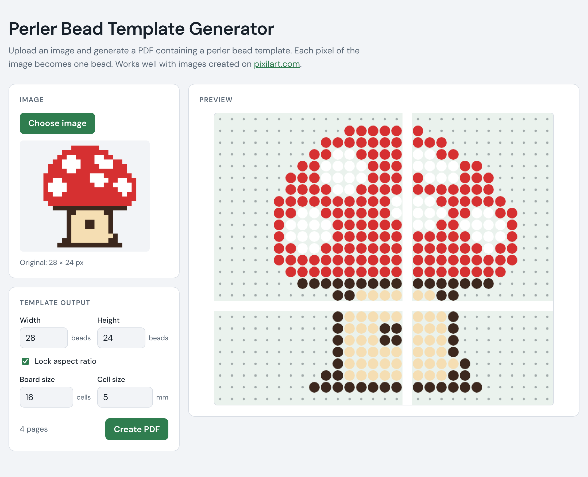

# Perler Bead Template Creator

Upload an image and get a printable PDF template with one bead per pixel.

It can be viewed at [https://perler.chrisbaumann.ch/](https://perler.chrisbaumann.ch/).

## Development

In the project directory, you can run:

### `npm start`

Runs the app with the [Vite](https://vite.dev) dev server.
Open [http://localhost:3000](http://localhost:3000) to view it in the browser.

The page will reload if you make edits.

### `npm test`

Runs the [Vitest](https://vitest.dev) tests in watch mode.

### `npm run build`

Type-checks and builds the app for production to the `dist` folder.

### `npm run deploy`

Publishes the app manually to the `gh-pages` branch.
Pushes to `main` are deployed automatically by `.github/workflows/deploy.yml`.

## Search engines

`index.html` has title and description, canonical address, Open Graph / Twitter card
(`public/social-card.png`) and structured data (`WebApplication`). `public/sitemap.xml` and
`public/robots.txt` end up in the root of the site, which is also the root of the domain
`perler.chrisbaumann.ch`. The site can also be added in the Google Search Console.
